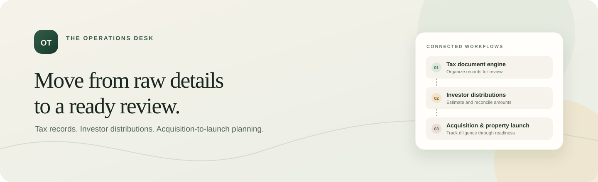
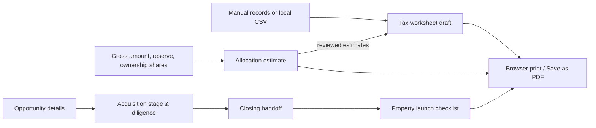
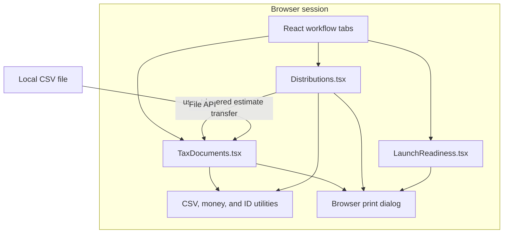

<div align="center">



# Operations &amp; Tax Studio

### Turn operational inputs into review-ready work.

An interactive React + TypeScript workspace for assembling tax-record drafts, estimating investor allocations, and coordinating an acquisition through property launch.

[Open the live preview](https://operations-tax-studio.shaqib-dev.chatgpt.site/) · [Explore the source](https://github.com/Skeeb32/tax-document-generator)

<br />

[](https://react.dev/)
[](https://www.typescriptlang.org/)
[](https://vite.dev/)
[](https://github.com/Skeeb32/tax-document-generator)

<sub>The hosted preview is private and requires sign-in. Application inputs stay in the active browser session.</sub>

</div>

---

## A quick look

Three workflows connect the day-to-day work behind investor operations:

| 01 · Tax records | 02 · Investor distributions | 03 · Acquisitions &amp; launches |
| --- | --- | --- |
| Organize financial records into a printable review draft. | Estimate ownership-based allocations and reconcile entered paid amounts. | Track diligence, closing, operational handoffs, and launch readiness. |



## Why this project exists

Operational work often crosses finance, investor relations, supply, and property operations. The source information may start in different places, handoffs need clear ownership, and review work can be easy to repeat manually.

Operations &amp; Tax Studio brings three related planning workflows into one small browser application. It demonstrates how validation, explicit review states, currency-safe allocation math, and clear handoff tracking can make operational tools easier to inspect and use.

## What you can do

### Tax document workspace

- Choose from **10 jurisdiction presets plus a custom option**, with document organizer templates that adapt to the selected jurisdiction.
- Choose a tax year and one of eight display currencies.
- Enter source records manually or import a CSV with `description`, `amount`, and optional `source` columns.
- Validate missing descriptions, missing amounts, negative or invalid amounts, malformed quoted CSV rows, and exact duplicate records.
- Generate a review worksheet with a listed-source total, notes, and a browser print / PDF path.
- Bring investor allocation estimates into the tax-record list for follow-up review.

### Investor distribution estimator

- Enter a gross distribution, reserve, distribution period, currency, and investor ownership shares.
- Validate inputs, duplicate investor references, the reserve limit, and the requirement that ownership shares total 100%.
- Calculate estimates in currency minor units and assign rounding remainders by largest fractional share.
- Optionally compare estimates with entered paid amounts and show per-investor and total variances.
- Send estimate rows to the tax-record workflow; they remain labeled as estimates for review.

### Acquisition-to-launch tracker

- Track an opportunity through **Opportunity identified → Initial review → Due diligence → Approval pending → Under contract → Closed → Launch preparation → Live**.
- Record a market, target closing date, target launch date, and operations lead.
- Assign owners and statuses across an editable diligence and readiness checklist.
- See checklist completion and blocked items in a printable acquisition and launch summary.

## How it is built

The app is intentionally client-side. React state holds the working values for the active page session; there is no application server, database, browser storage, payment processor, tax API, or operations-system integration in this repository.



### Engineering choices

- **Input validation at workflow boundaries:** required values and cross-field constraints are checked before summaries are generated.
- **Currency arithmetic in minor units:** allocations use integer subunits where applicable, then distribute residual subunits by largest remainder so rounded estimates add back to the distributable total.
- **Review before output:** summaries are generated explicitly from entered values, and print actions are disabled until a draft exists.
- **Small feature modules:** tax documents, distributions, and launch readiness are separate React components; shared record types and formatting/parsing utilities live in `src/types.ts` and `src/format.ts`.
- **Local-first handling:** CSVs are read by the browser and values are not saved to a server or browser storage.

### Technology

| Area | Implementation |
| --- | --- |
| UI | React 19 + TypeScript |
| Build and development server | Vite 8 |
| Type checking | TypeScript project references with strict compiler options |
| Styling | Responsive CSS in `src/styles.css` |
| CSV | Browser File API and a small in-project CSV row parser |
| Output | Browser print dialog, which can save a draft as PDF |
| Persistence / services | None; state is held in the active page session |

## Quick start

### Prerequisites

- Node.js **20.19+** or **22.12+**
- npm (bundled with Node.js)
- Access to this repository (it is currently private)

### Install and run

```bash
git clone https://github.com/Skeeb32/tax-document-generator.git
cd tax-document-generator
npm ci
npm run dev
```

Open the local URL printed by Vite. The app does not require environment variables or third-party API keys.

### Build and preview

```bash
npm run build
npm run preview
```

`npm run build` runs `tsc -b` and creates the production-ready static bundle in `dist/`. `npm run preview` serves that built bundle locally.

### Validation status

There is no automated test runner or `test` script configured yet. The build command performs the current TypeScript validation and production bundle build. Do not use real tax identifiers, bank details, or confidential investor data in this prototype.

## Try a workflow

### Import source records

Create a CSV with a header row (the header is optional):

```csv
description,amount,source
Interest income,125.42,Brokerage statement
Investor distribution,800.00,Investor distribution
Property operating expense,215.75,Financial record
```

In **Tax document engine**, select a jurisdiction and worksheet type, choose **Import CSV**, review the imported rows, then select **Generate review draft**. Use **Print / PDF** to print or save the worksheet from the browser.

### Estimate an investor distribution

1. Open **Investor distributions** and enter the property or fund, period, gross amount, and reserve.
2. Add investor references and ownership shares that total 100%.
3. Optionally enter paid amounts to see variance calculations.
4. Calculate the estimate, review the allocation table, and optionally add estimate rows to the tax workflow.

### Track a property opportunity

1. Open **Acquisition & property launch** and enter the property, market, stage, and target dates.
2. Update each diligence or readiness item's owner and status.
3. Add project-specific checklist items and notes.
4. Create a summary for review or print it to PDF.

## Project map

```text
src/
├── App.tsx              # Workflow tabs and shared tax-record state
├── TaxDocuments.tsx     # Jurisdiction templates, CSV intake, review drafts
├── Distributions.tsx    # Validated allocation and reconciliation estimates
├── LaunchReadiness.tsx  # Acquisition stages and property readiness tracking
├── format.ts            # Currency, CSV, and record ID helpers
├── types.ts             # Shared workflow data types
└── styles.css           # Responsive interface and print presentation
```

## Project snapshot

| Metric | Current implementation |
| --- | ---: |
| Core workflows | 3 |
| Jurisdiction presets | 10 + custom |
| Currency options | 8 |
| Acquisition pipeline stages | 8 |
| Starter diligence / readiness items | 13 |

The GitHub repository is **private**, so public star, fork, traffic, and activity counts are not available for meaningful badges. There is currently no CI workflow, published release, coverage configuration, or license file in the repository; this README does not display badges for them. The live preview is private as well.

## Roadmap

### In the current prototype

- [x] Tax-record worksheets with jurisdiction and document-type selection
- [x] CSV import, source validation, and duplicate review
- [x] Ownership-based distribution estimates and entered-payment reconciliation
- [x] Acquisition stages, diligence items, and launch readiness summary
- [x] Browser print / PDF output

### Possible next steps (not implemented)

- [ ] Add an automated test suite for input validation, CSV parsing, and allocation rounding
- [ ] Add CI for type checking, build verification, and preview deployment
- [ ] Define an explicit persistence, access-control, and audit-history model before storing financial records
- [ ] Add jurisdiction-specific official-form support only with verified requirements and qualified review
- [ ] Add a license and contribution policy before opening the repository to public reuse

## Contributing

Contributions are welcome from people with repository access. For a focused change:

1. Open an issue describing the workflow problem or proposed improvement.
2. Create a branch from `main` and keep the change scoped to one workflow where practical.
3. Install dependencies with `npm ci`.
4. Run `npm run build` and manually check the affected workflow at desktop and narrow widths.
5. Open a pull request with the user-facing change, validation performed, and any relevant screenshots.

Please do not include real personal, tax, banking, or investor data in issues, screenshots, fixtures, or pull requests. The project currently has no license file; ask the repository owner before redistributing or reusing code.

## For recruiters and engineers

This repository demonstrates a compact, end-to-end frontend implementation around real operational constraints:

- translating finance and operations concepts into three connected workflows;
- designing TypeScript domain types for financial records, allocations, and readiness items;
- validating cross-record invariants before producing review output;
- handling fractional currency allocation without losing minor units;
- parsing user-selected CSV files locally and surfacing malformed or duplicate data;
- connecting feature modules through an explicit user-triggered workflow handoff;
- producing printable summaries without claiming tax filing or payment capabilities.

The implementation is a browser-only prototype. It has no backend, external integrations, automated tests, production tax-rule engine, payment processing, persistent storage, or measured scale/performance results.

## Use it, inspect it, improve it

If you have access to the repository, try the live preview, explore the workflows, and open an issue or pull request with a concrete improvement. If the project is made public later, consider adding a license and CI first, then star ⭐, fork, and share it with the community.

<div align="center">

**Operational workflows, made easier to review.**

</div>
